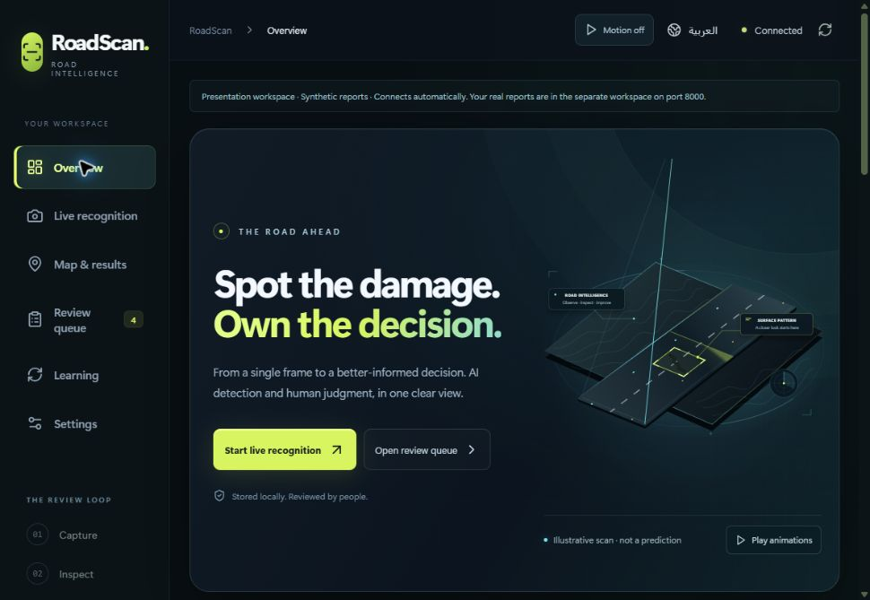
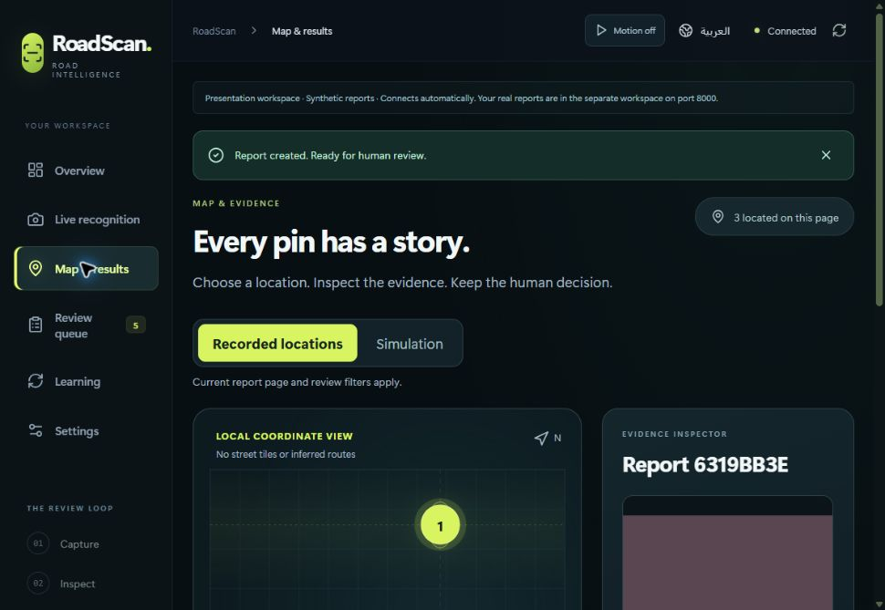
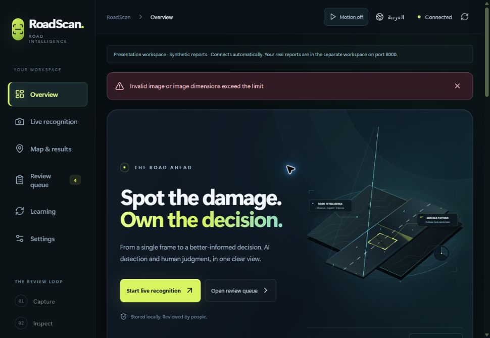
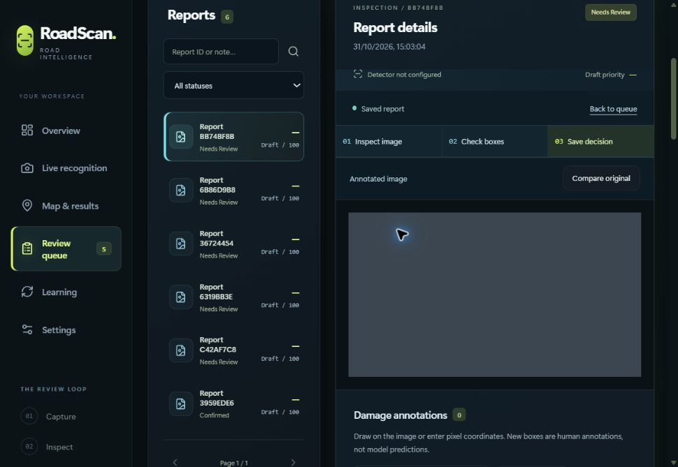
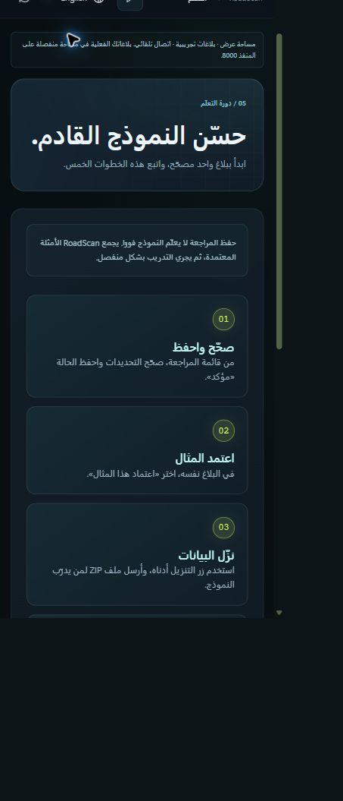

# RoadScan interface and map update — 31 October 2026

## Start here

1. Open RoadScan and connect using your local access token.
2. **Overview:** upload a photo, start live recognition, or open a recent report.
3. **Map & results:** choose a recorded location, inspect its evidence, then open the review.
4. **Review queue:** correct boxes and notes, choose a status, and **Save review**.
5. **Learning:** approve the reviewed example, export it, train separately, evaluate, then import the new model.

Reviewing a report does **not** change the running model. Training and evaluation remain separate steps.

## What the map means

The coordinate plot shows locations from the current report page and filters. It is not a street basemap, route planner, embedded Google Maps service, or drone-control system. Manual coordinates and reported device-GPS coordinates are labeled; the app does not verify the GPS source. Simulation is separate. Reports without a known location remain available without invented pins. Zero coordinates are valid; unknown legacy provenance does not produce an external map link.

Selecting a pin opens its image, annotations, draft priority and review link. **Open in Google Maps** opens an external coordinate search only for manual or reported device-GPS coordinates. The draft priority remains an unvalidated rule, not a measured severity score.

## Verified in this update

- TypeScript and production build passed; **30 frontend tests passed**, no skips.
- **116 backend/API regression tests passed**, no skips; one dependency deprecation warning. No backend change followed those tests.
- Browser checks: saved review and training approval survive reload; unsaved-review warning focuses its actions; keyboard navigation; empty map/filter state; recorded/unknown/zero/simulated locations; English and Arabic layouts; 375-pixel phone layout without horizontal overflow; motion toggle.
- A malformed image was rejected without creating a report. Its error now receives focus, and a minimum-height preview keeps **Remove photo** clickable.
- A **3840 × 2160 synthetic image** uploaded through the browser and created a saved report. This verifies upload/review plumbing, not detector accuracy.
- One intentional-empty synthetic training example was exported and its ZIP contents verified; model weights remained unchanged.
- Production retained **19 reports**, and the stopped demonstration workspace retained **9 reports**. Before/after file hashes matched for both data volumes, including the model catalog. Existing container configuration and original road illustration were preserved.

## Evidence and limits

All screenshots above use isolated synthetic test data, not measured road detections. The earlier report/PDF and presentation retain their dated evaluation snapshots; read this supplement with them. Existing model metrics do not become new accuracy results through an interface update.

No new model training, Saudi test-set collection, drone field test, physical-camera acceptance, full model benchmark, fresh-machine installation, native PowerPoint playback, or operating-system reduced-motion emulation was performed in this update. The motion control and responsive layouts were checked directly. See [validation status](Validation-Status.md), [models](Models.md), and [quick start](Quick-Start.md).

The production container was subsequently replaced with a verified source-built image. All 116 backend tests passed inside that image, and Main completed a synthetic recognition request without saving a report. The existing volumes, runtime settings and data were preserved; see [runtime persistence](Runtime-Persistence-2026-10-31.md) for the exact evidence and limits. The source package contains the same application changes for subsequent builds. Backups and detailed private preservation receipts remain on the owner's laptop and are excluded from this public package.
