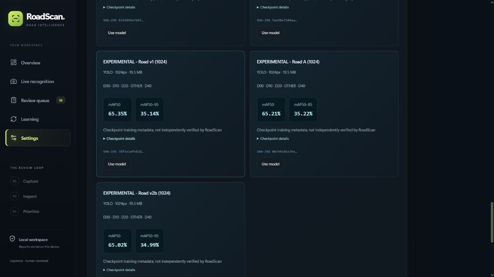

# RoadScan submission audit — 30 October 2026

**Read this alongside the dated report and slides.** The application works locally; this does not mean every course evaluation requirement is complete. The report PDF and presentation remain the 27 October snapshot, with 14 report pages plus four appendices and seven main slides plus four optional slides. This supplement records later model integration and the remaining evidence gaps without rewriting historical results.

## What changed after the report

- The inventory now contains **22 distinct weight hashes: 19 road detectors, one image classifier, one COCO initializer and one DINOv2 embedding backbone**. The model-library screen lists the 19 compatible detectors, not all 22 roles.
- The new package's original model is byte-identical to the retained main YOLO26s. Three additional choices are **EXPERIMENTAL - Road v1 (1024)**, **EXPERIMENTAL - Road A (1024)** and **EXPERIMENTAL - Road v2b (1024)**.
- On 29 October, all four package checkpoints completed restricted loading and actual CPU inference at 1024 pixels on one synthetic image and one supplied road image, sequentially in isolated containers. On 30 October, the three distinct labels were verified in the browser. The active selection file still exactly matches its pre-import bytes; Main remains selected. This is compatibility evidence, not accuracy or sustained frame-rate testing.
- The original pretrained YOLO11n road baseline is already published with its separately licensed source packet. DINOv2 is also published; neither source download nor classifier/embedding weights replace a road detector automatically. The [22-weight matrix](Model-Release-Matrix-2026-10-30.md) separates availability, permission, source terms and reproducibility for every SHA.
- The public source repository exists and was verified reachable; the older report's statement that a public repository was not yet established is historical. Publishing the repository does not establish meaningful commits or contributions by each teammate.

The screenshot documents controls and naming. Its checkpoint training metrics are not the supplied road-test metrics and are not independent accuracy measurements.

## Course requirements: evidence and remaining work

The instructor's supplied OLO AIEP brief, Track A (pages 6–10), and deliverable rules (pages 38–41) are the requirements source. It is not republished here.

| Requirement | Evidence available | What still needs completion |
|---|---|---|
| Four-class localized detection and review | Box detection, editable classes/coordinates, review history and model comparison; fifth OTHER source class is mapped explicitly | An unseen panel-selected input must still be demonstrated live |
| Documented 0–100 priority and ±20% sensitivity | Report section 8, `roadscan/priority.py`, interface and replacement ranking tool | Representative-road ranking sensitivity results; the score is not physical depth or certified severity |
| DINOv2 crop embeddings, vector search and GPS filtering | `roadscan/duplicate_finder.py`: normalized features, exact FAISS search, 50 m default radius, open-report filtering, advisory results | Genuine same/different-damage pairs, validation-only threshold selection, held-out Recall@1/5, precision/recall and ROC results |
| Genuine local field test set | Collection/labeling guide and separate evaluator exist | Collect and label 40–80 city-road photos, protect them from training/selection, and evaluate them; the 923 video frames do not establish this independent set |
| E1 classifier versus detector | Supplied classifier/detector comparison and interpretation in report | Original classifier initializer/terms and complete original run provenance remain unresolved |
| E2 detector size/resolution and CPU trade-off | Supplied size/resolution experiments and limited runtime checks | Common, appropriately held-out evaluation and comparable CPU latency; two-image smoke checks are insufficient |
| E3 augmentation | Supplied ablation table and physically implausible vertical-flip discussion | Reproducible split/run mapping; no new experiment claimed |
| E4 country and local domain shift | Supplied held-out-country results and disclosed near-duplicate concerns | Repaired sequence-aware splits and genuine local test evaluation |
| E5 duplicate embeddings | Supplied pHash/ResNet/DINOv2 simulation results; replacement matcher implementation | Real-pair retrieval evaluation; simulation F0.5 is not deployed duplicate accuracy |
| Detection metrics and threshold justification | Supplied mAP, per-class figures and validation tools | Shared independent evaluation, protected local precision/recall/confusion/F1-threshold curves; selection-set results must not be called final test scores |
| CPU and end-to-end latency | Historical isolated CPU checks and bounded new-model compatibility evidence | A representative repeatable latency study, hardware conditions and batch coverage |
| Report, architecture, code, privacy and errors | 18-page PDF, editable DOCX, source excerpts, screenshots and limitations; README images and documentation links checked | Current supplement must accompany older binary artifacts; native Word pagination remains unverified |
| Team contribution statement | Three names are correct | Each member must supply an accurate role/contribution account and meaningful commits; no roles or history fabricated |
| Demo and presentation | English seven-slide main story, four appendices, code/data-flow overview and speaker notes | Rehearse the panel's unseen-input flow and actual hardware; the brief asks for a longer presentation/demo slot |
| Fresh-process artifact inference | HTTP recognition command and pinned Docker setup documented; trained baseline/source/checksums published | The fresh public-download-to-inference acceptance run remains explicitly uncompleted |

The automatic upload similarity hint is legacy dHash. The separate on-demand crop/GPS search uses DINOv2/FAISS; the health endpoint's `dhash_unvalidated` label must not be interpreted as a runtime result for that separate search. No new real-pair matching claim is made here.

## Working demonstration path, without retraining

Use the existing [Docker setup](Run-On-Another-Computer.md), the published baseline plus its source/notices, and the existing model-library import/activation flow in [Inference and reproducibility](Inference-and-Reproducibility.md). Then analyze a new road image and inspect the returned state and boxes. Use [Iriun](Iriun-Webcam-Guide.md) only after its picture appears in the computer companion; the browser consumes that camera feed.

This is a documented available path, **not a newly passed clean-machine acceptance test**. The live workstation and prior isolated CPU checks are narrower evidence. No retraining, paid API or cloud fallback is needed for local inference after dependencies and a compatible checkpoint are installed. The first build/download still requires internet access.

Camera recognition samples at achievable throughput. Uploaded-video **Analyze every frame** processes decoded frames sequentially and can be slower than playback; it is not a promise that every codec decodes without error. Human review saves corrections for later training; it never changes weights live. Minority-model selection is allowed and remains a draft until saved.

## Documentation and presentation audit

- The initial link audit checked 18 Markdown documents and 97 local links/images: none were missing. A post-edit link and checksum check accompanies this update.
- The report covers the requested structure, including experiments, architecture, code evidence, privacy, limitations and a contribution section that honestly remains incomplete.
- The main presentation contains the code/data flow (`App.tsx`, `api.py`, inference, review, storage and training export). Its seven-slide script targets five minutes; this is a planned duration, not measured rehearsal time. The timing guide is aligned with the script.
- Slide 8 and the older model report describe the 19-weight snapshot; this supplement and updated spoken notes explain the three later additions. Existing binaries are retained as dated evidence, not represented as regenerated artifacts.
- Native PowerPoint playback/animation and physical Iriun/drone operation were not checked in this audit. The deck is static. Screenshots are useful evidence and fallback material, but the course explicitly requires a live panel-selected input.

## Precisely bounded stopped operations

An earlier automatic approval review rejected a **combined documentation/baseline setup integration operation** before execution with only “blocked by policy.” Its recorded targets were candidate inventory JSON/CSV, candidate Models.md, the model-report generator, and a new baseline-download acceptance model directory/private `.env`. The exact triggering substep is unknown; the full command was not safely reconstructed. Candidate root README/Models.md patches and the downloader integration remain held. This audit does not execute, split or relocate that acceptance workflow, create credentials, regenerate the model report, or publish those held patches. Consequently, download-to-setup-to-inference acceptance is still unverified; existing independent anonymous asset/hash checks remain valid evidence.

A separate rejected **combined staged-PPTX metadata / Windows RAM / disk diagnostic** remains stopped. No resource-admission probe, slide-transition metadata reconstruction or full common-set benchmark was run. Reading the current published report/slide text for this requested content audit does not establish native playback or resource headroom. The earlier denied browser downloads page was not reopened.

These boundaries do not prohibit unrelated link checks, current model evidence, this new matrix, or independent presentation/documentation corrections. UI overhaul and Hermes remain deferred to the owner's priority decision after the GitHub blockers are reconciled.

## Decisions and inputs still needed

1. Trainer source/initializer confirmations listed **per weight** in the matrix; no repeated blanket publication approval is requested.
2. Genuine local photos and duplicate pairs, plus truthful member contribution statements. These cannot be generated as if the team had already collected or authored them.
3. A supported resolution of the exact denied acceptance operation if a fresh end-to-end claim is required; it will not be retried through another route.
4. Owner decision on remaining submission gaps before resuming design; the application remains usable while these are unresolved.
