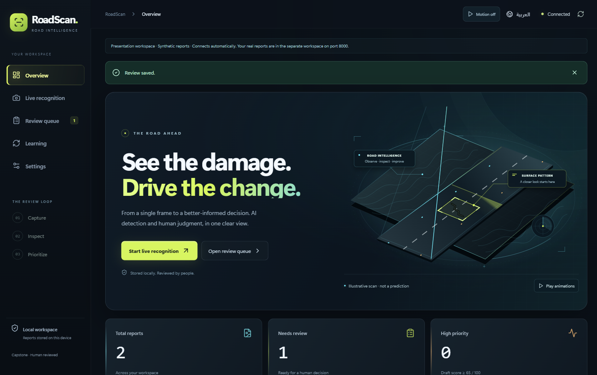
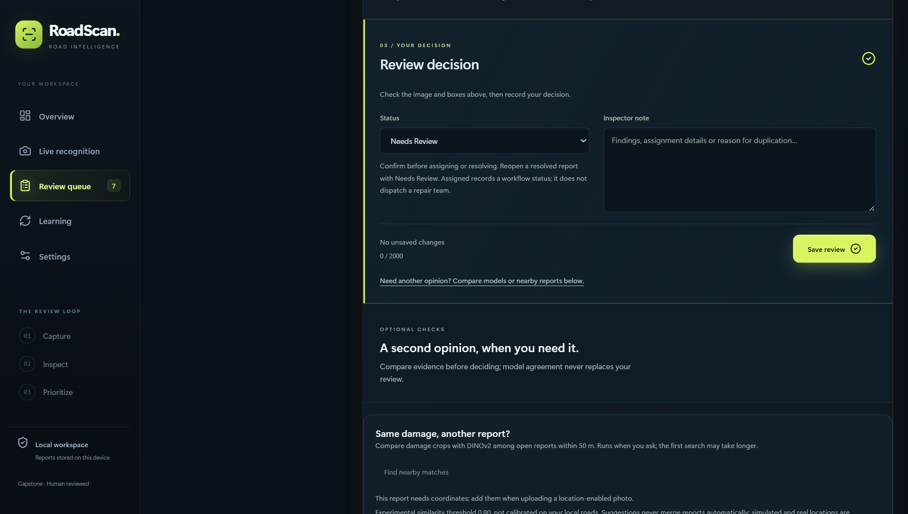
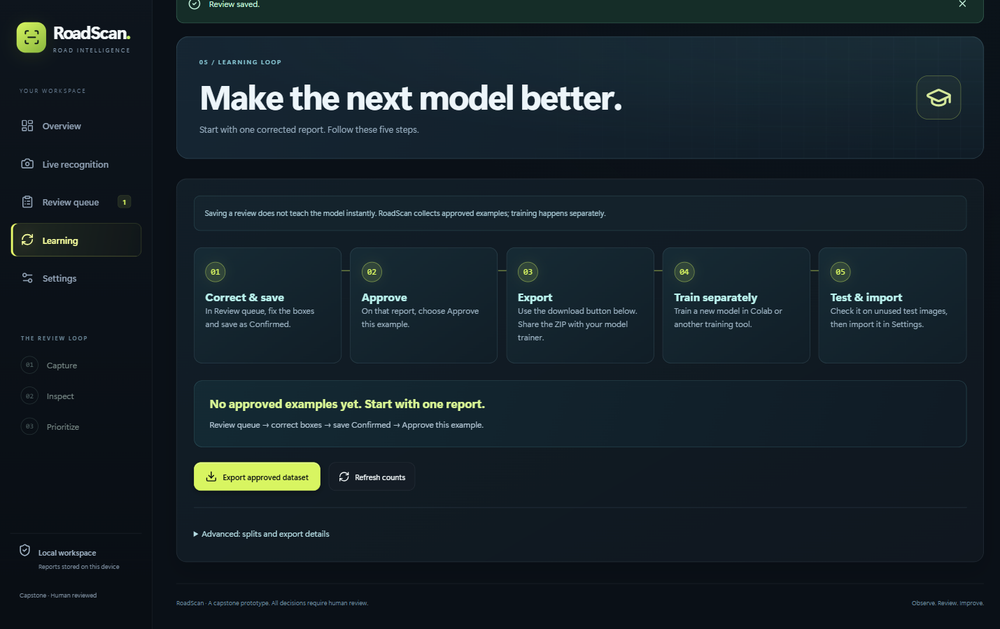

# RoadScan

**Road damage recognition. Human review. A controlled learning workflow.**

By Feras Alyamani, Ahmed Salamah and Ahmed Alhejaili.

[Report](Deliverables/RoadScan-Project-Report.pdf) · [Slides](Deliverables/RoadScan-Presentation.pdf) · [Run RoadScan](#quick-start--windows) · [Iriun camera](Deliverables/Iriun-Webcam-Guide.md) · [Models](Deliverables/Models.md) · [Benchmarks](Deliverables/Validation-Status.md)



*Actual RoadScan demo interface, 27 October 2026. The road scene is illustrative artwork, not a model prediction.*

| Inspect | Decide | Improve |
|---|---|---|
| Photos, camera/Iriun/USB and sequential video analysis | Correct boxes, compare models and save a human decision | Approve examples, export a dataset and evaluate a separately trained checkpoint |

RoadScan runs the interface, API and CPU detector together in Docker. Reports and model files stay in the local workspace; English and Arabic screens share the same review flow.

Release **2026-10-27.1**. Final submission documents are indexed in [Deliverables](Deliverables/README.md). Access tokens, private reports and raw datasets are excluded; public model-release preparation is described in [Models](Deliverables/Models.md).


## Instructor deliverables

| File | Description and status |
|---|---|
| [Project report — PDF](Deliverables/RoadScan-Project-Report.pdf) / [DOCX](Deliverables/RoadScan-Project-Report.docx) | 18-page report with results and screenshots; PDF checked, Word pagination unverified |
| [Presentation — PDF](Deliverables/RoadScan-Presentation.pdf) / [PPTX](Deliverables/RoadScan-Presentation.pptx) | Twelve slides: seven main plus five appendices; static slides, native playback unverified |
| [Speaker notes](Deliverables/Speaker-Notes.txt) / [presentation guide](Deliverables/Presentation-Guide.md) | English five-minute main script and timing |
| [All documentation](Deliverables/README.md) / [quick start](Deliverables/Quick-Start.md) | Setup, use, learning, model inventory and validation status |
| [Models and download status](Deliverables/Models.md) / [validation limits](Deliverables/Validation-Status.md) | 22 weights: 12 public mirrors (11 road detectors + DINOv2), one official initializer link, nine individual holds; common-set benchmark pending |
## Quick start — Windows

**RoadScan runs the website, API and CPU detector together in Docker.** You do not need a GPU, Python or Node installed on your computer.

**Before starting:** open Docker Desktop with **Linux containers**, allow about **4 GB of Docker memory** and keep **10 GB free**; the first build needs internet and can take several minutes.

### 1. Get the project

Use **Code > Download ZIP** and extract it, or run the commands below if Git is installed. The source repository is public.

```powershell
git clone https://github.com/Feras-MQ/RoadScan.git
cd RoadScan
```

### 2. Start it

Open PowerShell in the extracted/cloned folder that contains `compose.yaml`, then paste these commands:

If this computer already has RoadScan reports, first follow [existing-installation checks](Deliverables/Run-On-Another-Computer.md#existing-installations-preserve-your-project-name) and keep the original project name; the commands below are for a new `roadscan` project.

```powershell
docker run --rm --mount "type=bind,source=$($PWD.Path),target=/workspace" -w /workspace python:3.11-slim@sha256:e88e9763f943ec1834f992a4b51e0f24500486803e8bc534e5767af9ea65f6ce python tools/prepare_local_env.py
docker compose -p roadscan up --build -d
.\COPY_ACCESS_TOKEN.cmd
```

These are the canonical commands for a **new source-only installation**. The helper creates a private `.env`, enables the CPU detector build and preserves an existing `.env`; it never prints your token. The Windows launcher also supports source-only folders: it defaults to a CPU detector build and respects explicit `ROADSCAN_WITH_DETECTOR=0` or `1` settings (process environment first, then `.env`). Model weights still need importing.

**Already have reports?** Keep the existing Compose project name and data volume. Do not run the `-p roadscan` example over an installation created under a different name: follow [existing-installation checks](Deliverables/Run-On-Another-Computer.md#existing-installations-preserve-your-project-name). The launcher stops on ambiguous or different existing RoadScan projects instead of silently choosing new storage.

### 3. Open and connect

Open **http://127.0.0.1:8000**, paste the copied token into **Access token**, and select **Connect**; run **COPY_ACCESS_TOKEN.cmd** again whenever you need to copy it.

For a GitHub download, install a model next: **Settings > Your model library > Browse models** (or drag a file) > choose a trusted team `.pt` or `.zip` > **Use model** > check **Active**. Importing alone does not activate a model.

**Download a road detector:** [Main YOLO26s (1024)](https://github.com/Feras-MQ/RoadScan/releases/download/model-resources-2026-10-28/9f940caa9222-main_yolo26s_1024.pt) or the smaller [original baseline](https://github.com/Feras-MQ/RoadScan/releases/download/model-resources-2026-10-28/2bb146ad53a3-roadscan_baseline_best.pt). Verify the full SHA256 and read the source/license links in [Models](Deliverables/Models.md), then import > **Use model** > verify **Active**. The experimental fine-tunes and their individual evidence are listed there too; availability does not establish an accuracy ranking. No paid inference API is required.

### 4. Confirm it works

```powershell
docker compose -p roadscan ps
Invoke-RestMethod http://127.0.0.1:8000/api/health | Select-Object status, model, model_reason
```

Expect **status = ok** and, after installing/activating a model, **model = configured**; `not_configured` is expected in a source-only workspace before model installation. Health alone does not prove detection works.

In **Overview**, choose **Browse files**, select one road photo and click **Analyze & create report**, then open its report and check **Analysis complete**; inspect the boxes, save a review note and refresh to confirm it remains saved. A photo with no detected damage can legitimately have zero boxes.

<details>
<summary>Already have the team’s Ready-To-Run ZIP?</summary>

Extract `RoadScan-Ready-To-Run-2026-10-27.1.zip`, open its `RoadScan` folder and double-click **Start-RoadScan.cmd**. This separate local bundle includes the baseline model and copies your token; then follow **Open and connect** above. It is not a published GitHub download.

</details>

## Use the project

| Task | Where to go |
|---|---|
| Photo inspection | Overview > Browse files > choose photo > Analyze & create report > open the saved report |
| Camera / Iriun / USB | Live recognition > Camera > select your camera > Start live recognition |
| Every decoded video frame | Live recognition > Video - analyze every frame > choose the file > Analyze every frame; keep the tab visible |
| Human decision | Review queue > Inspect image > Check boxes > Save decision |
| Compare models | Saved report > Run model vote > choose agreement **or any individual model**, including a minority result > check boxes > Save review |
| Improve a later model | Save a Confirmed review > approve the training example > export from Learning; retraining and testing are separate steps |

## Stop and restart

From the **same project folder**:

```powershell
docker compose stop
docker compose start
```

For the Ready-To-Run bundle, you can also reopen **Start-RoadScan.cmd**. Reports and imported models stay in the Docker data volume; keep that volume and your `.env`, and do **not** use `docker compose down -v` to restart or update.

<details>
<summary><strong>Troubleshooting and advanced details</strong></summary>

| Problem | What to do |
|---|---|
| Docker command fails | Open Docker Desktop, wait until its engine is running and confirm Linux containers are selected |
| Port 8000 is already in use | Open the existing RoadScan first; stop only the conflicting workspace you own before starting another |
| Invalid token | Run COPY_ACCESS_TOKEN.cmd from this project's folder and paste again; the presentation demo on port 18004 is a separate prepared workspace |
| Model is not configured | Import a trusted team checkpoint and choose **Use model** |
| Model import says detector build is required | In this local `.env`, set `ROADSCAN_WITH_DETECTOR=1` without changing the token, then run `docker compose up --build -d`; the helper deliberately preserves existing settings |
| Imported file is rejected | Keep the rejection reason, use a supported trusted YOLO/RT-DETR `.pt` or model ZIP, and keep the previous working model |
| App is slow on a heavy model | Try the smaller supplied model for camera use; full video analysis deliberately waits for each frame's inference |
| Camera is missing | Allow browser camera access and check that Iriun/USB appears as a camera on this computer |
| Old screen after an update | Refresh the page once |

Logs: `docker compose logs --tail 50 roadscan` (inspect locally; redact sensitive content before sharing).

**macOS/Linux:** use the separate [CPU Docker guide](docs/CPU_DOCKER.md); physical Mac/ARM installation remains unverified. The Windows/Docker path and isolated Linux x86-64 CPU inference have been checked; this is not a claim about every computer.

**Location and drones:** localhost is this computer only; a remote phone or drone cannot connect directly to that address. Iriun/USB capture and imported recordings are supported inputs; direct drone integration and physical drone testing remain future work.

**Project map:** `frontend` = interface, `roadscan` = API/inference/review, `tests` = software checks, `tools` = setup helpers, `docs` = detailed guides, `models` = separately supplied weights. The app runs as one Docker service; you do not need to start the frontend separately.

Detailed guides: [live recognition and models](docs/LIVE_AND_MODELS.md), [learning and deployment](docs/LEARNING_AND_DEPLOYMENT.md), [replacement research tools](docs/Replacement-Tools.md), [third-party notices](THIRD_PARTY_NOTICES.md).

</details>

## Review before deciding



*Public edition: review controls; the original road-photo example is omitted. Reviewers can correct boxes and labels, choose an individual model even against a voting majority, and save a note and status. This interface screenshot is not measured accuracy.*

## Learning is an explicit process



**Correct and save → approve → export → train separately → evaluate → import.** Saving a review does not change the active model’s weights. Keep evaluation images out of the training export.

## Model access

See [Models](Deliverables/Models.md) for the current 22 weights, hashes, license conditions and publication status; the older 19-weight inventory is a dated snapshot. Use [this repository’s Issues](https://github.com/Feras-MQ/RoadScan/issues) for support, provenance or licensing questions.

Model weights are supplied separately from source code. The full common-set comparison remains incomplete; there is no verified universal top-five ranking. Only import trusted checkpoints with compatible road-damage classes. Generic COCO models are not road-damage-trained models.

## Evidence and limits

This release passed 221 backend tests (1 optional skip), 24 frontend tests and 67 browser checks: 17 interaction checks, 40 EN/AR responsive cases and 10 final narrow-screen rechecks. The TypeScript/Vite build passed. The earlier CPU Docker baseline has a separate inference proof; fresh Mac/ARM installation remains unverified. See [the design and workflow evidence](docs/DESIGN_REVIEW_2026-10-27.md). These are software checks, not field accuracy. Real Saudi test photos, duplicate calibration and repaired split evidence remain outstanding. The public report, slides and guides are in [Deliverables](Deliverables/README.md); weight availability is listed separately in [Models](Deliverables/Models.md).

## Tests

Use a disposable development checkout with a scratch database and storage, never a private-report workspace: run `python -m pytest` in that configured environment and `npm test` in `frontend` after installing its locked dependencies. `python tests/test_prepare_local_env.py` tests CPU setup using only Python's standard library. See [third-party notices](THIRD_PARTY_NOTICES.md).
